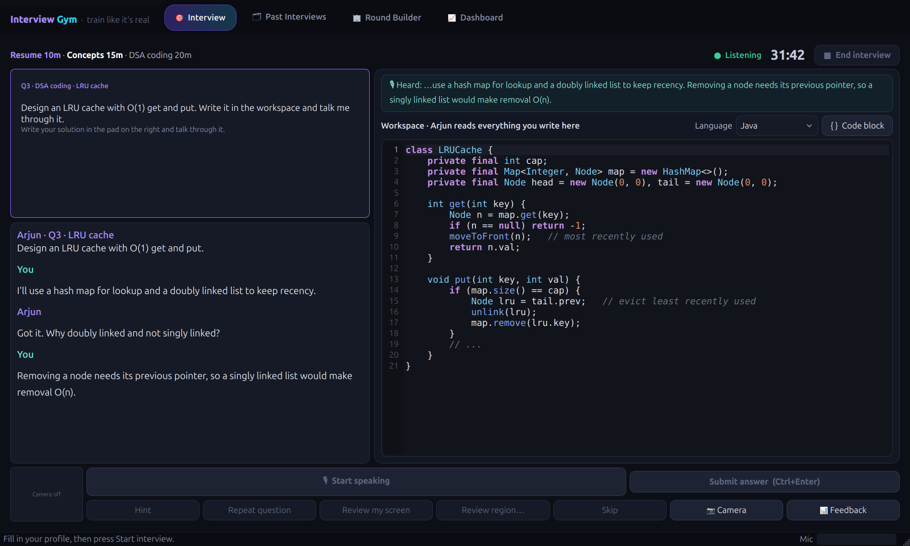
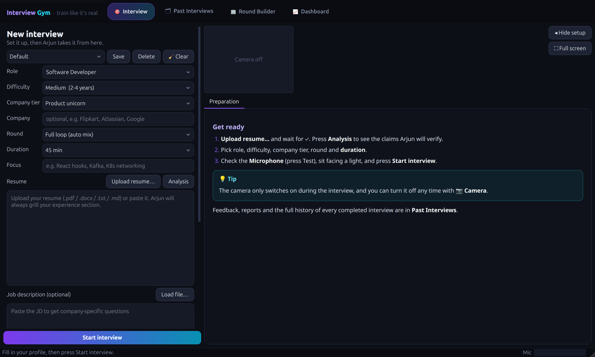
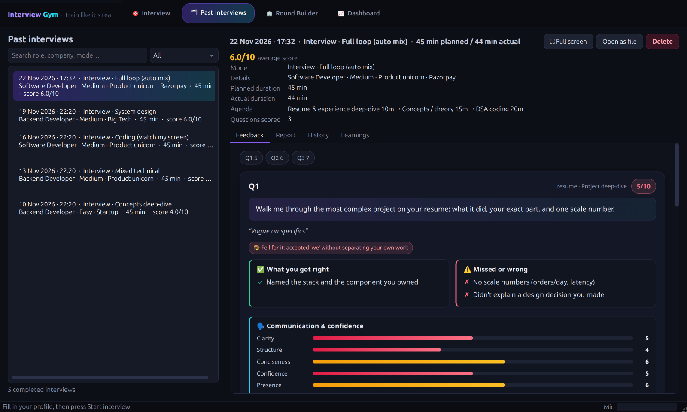
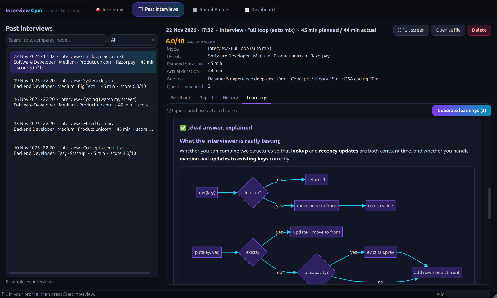
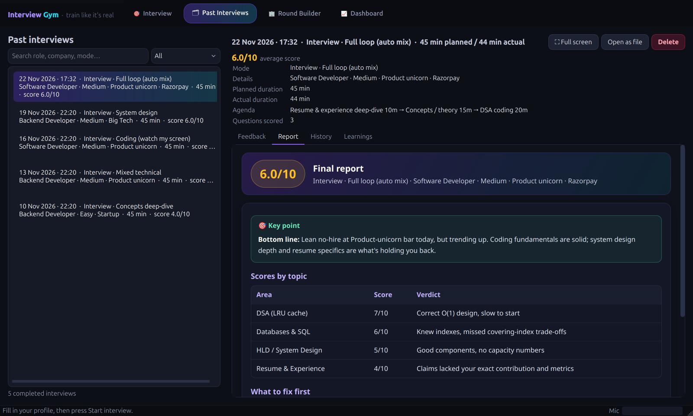
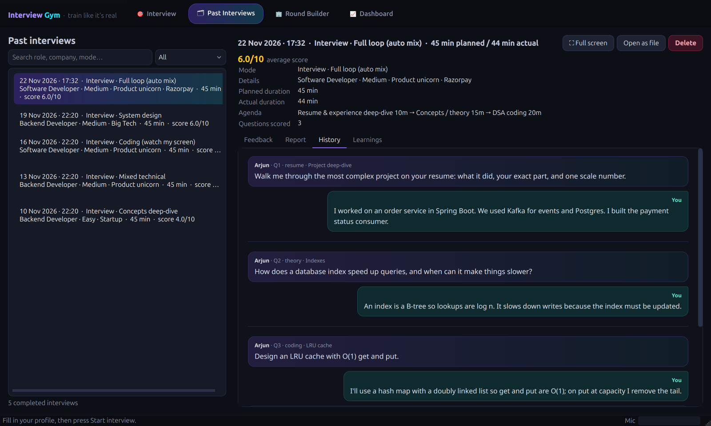
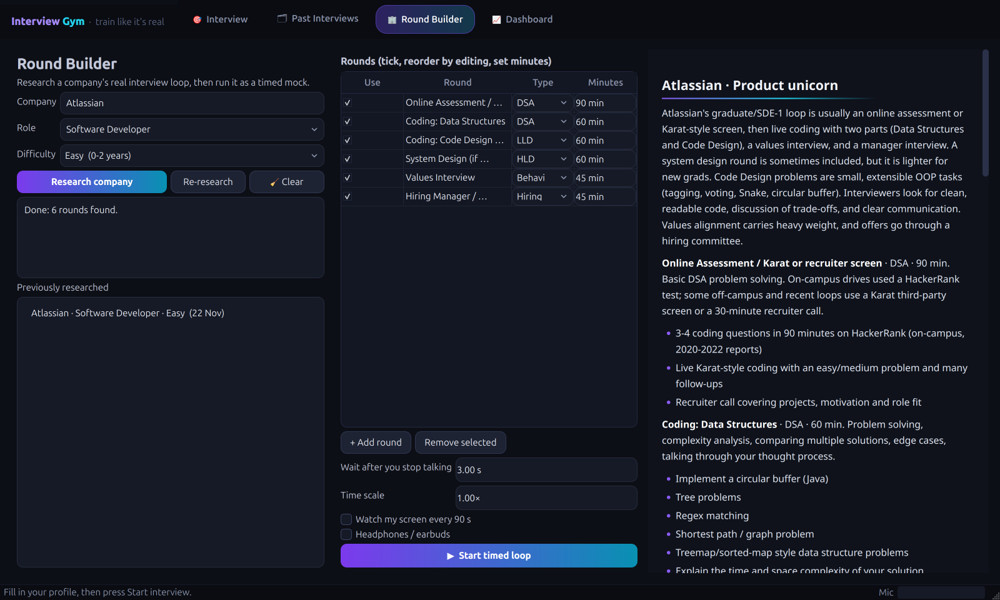
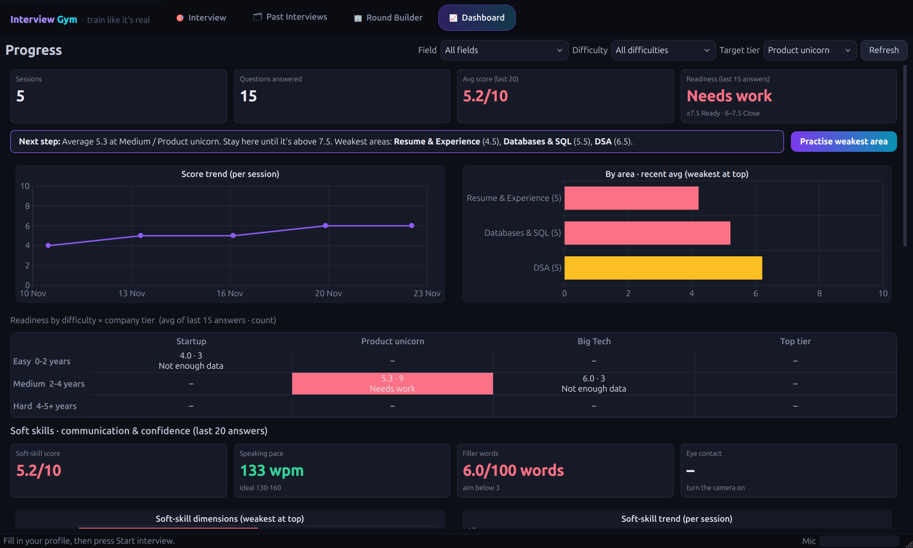

# Interview Gym

**Practise tough IT interviews out loud, on your own Ubuntu laptop, with an AI interviewer that listens, pushes back and grades you.**

The interviewer, "Arjun", talks to you in a natural voice, waits until you've finished speaking, digs into your resume, watches the code you type, sets traps, and writes detailed feedback, a report and study notes after every interview. Speech recognition, the voice, the camera analysis and all your data stay on your machine; the interviewer's brain is Claude, used through your own Claude subscription.



> All screenshots use sample data.

## Contents
- [What it does](#what-it-does)
- [Screenshots](#screenshots)
- [Requirements](#requirements)
- [Setup](#setup)
- [Review guide: check that everything works](#review-guide-check-that-everything-works)
- [Everyday use](#everyday-use)
- [How the interviewer behaves](#how-the-interviewer-behaves)
- [Features in detail](#features-in-detail)
- [How it works](#how-it-works)
- [Data and privacy](#data-and-privacy)
- [Troubleshooting](#troubleshooting)
- [Project layout](#project-layout)
- [Credits and licences](#credits-and-licences)

## What it does

| Tab | What you get |
|---|---|
| **Interview** | A timed, hands-free mock interview (15 min to 2 hr) for Software, Frontend, Backend, Full Stack, DevOps, LLD/HLD or DSA roles. Claude plans an agenda (resume, theory, coding, machine coding, system design, behavioral) to fit the time. One big workspace for code and notes, with syntax colouring for 11 languages. |
| **Past Interviews** | Every completed interview with **Feedback** (scores, traps, claim checks, soft skills, model answers), the final **Report**, the full **History** as a chat, and **Learnings**: ideal answers with diagrams, your mistakes, a "how to say it" version, likely follow-ups and verified study links. |
| **Round Builder** | Type a company: Claude researches its real interview loop on the web, lists the rounds with reported questions, then runs a timed loop of similar (not identical) problems with a hiring-committee debrief. |
| **Dashboard** | Score trend, weakest areas, readiness by difficulty × company tier, soft skills (pace, filler words, eye contact) and an improvement plan. |

## Screenshots

| | |
|---|---|
| **Setup** — role, difficulty, company tier, round, duration, resume, mic and voice<br> | **Live interview** — question, conversation, workspace with Java colouring, what Arjun heard<br> |
| **Feedback** — score per question, trap verdict, right vs missed, communication scores<br> | **Learnings** — ideal answer explained with a diagram, key points, mistakes, links<br> |
| **Report** — bottom line, scores by topic, what to fix first<br> | **History** — the whole interview as a chat<br> |
| **Round Builder** — researched company loop with reported questions and sources<br> | **Dashboard** — progress, weak areas, readiness matrix, soft skills<br> |

## Requirements

| Need | Details |
|---|---|
| **OS** | Ubuntu 22.04 or newer with GNOME (developed and tested on Ubuntu 26.04, Wayland). Other Linux desktops with PipeWire should work but are untested. Not for Windows or macOS. |
| **Python** | 3.10 or newer (tested with 3.14), plus `python3-venv`. |
| **Claude** | The [Claude Code](https://claude.com/claude-code) CLI, logged in with a **paid Claude plan (Pro or Max)**. The Free plan doesn't include Claude Code. No API key needed. A 45-minute hands-free interview makes roughly 100+ requests: Pro works but you may hit its limits on long sessions; Max is comfortable. |
| **Audio** | A microphone and speakers or headphones. PipeWire (`pw-play`, `pw-dump`) and ALSA (`arecord`), which are standard on Ubuntu. Headphones or earbuds are recommended. |
| **Camera** | Optional. Any webcam (`/dev/video0`) for confidence and eye-contact feedback. |
| **Hardware** | Any recent x86-64 CPU with 4+ cores and 8 GB RAM. **No GPU needed.** |
| **Disk** | About 2.5 GB: ~1.4 GB of Python packages and ~800 MB of models downloaded on first use. |
| **Internet** | Needed for Claude and for the one-time downloads. Speech, voice and camera then work offline. |

## Setup

**1. System packages** (most are already installed on Ubuntu):

```bash
sudo apt install git python3-venv alsa-utils pipewire-bin xdg-desktop-portal-gnome
```

**2. Claude Code** — install it and log in once:

```bash
curl -fsSL https://claude.ai/install.sh | bash
```

```bash
claude
```

In Claude, type `/login`, choose **Claude account with subscription**, finish the login in your browser, then type `/exit`. Check it works:

```bash
claude -p "Say ready"
```

**3. Get the code and start the app:**

```bash
git clone https://github.com/rahulsg98/Interview-Gym.git
```

```bash
cd Interview-Gym && ./run.sh
```

The first run creates a virtual environment in `.venv` and installs the Python packages (a few minutes), then opens the app.

**4. Add it to the Applications menu** (optional but handy):

```bash
./install-desktop.sh
```

After that, open it like any app: press **Super**, type **Interview Gym**, press Enter.

**What downloads on first use** (once, into `~/.local/share/interview-gym/models`):

| Model | Size | When |
|---|---|---|
| NVIDIA Parakeet TDT 0.6B v2 (speech to text) | ~650 MB | First interview |
| Kokoro-82M (natural voice) | ~120 MB | First interview or voice preview |
| Mermaid (diagrams in reports) | 3 MB | First launch |
| YuNet face detector | 0.2 MB | First time the camera is on |
| Piper voice / Whisper model | 60–250 MB | Only if you pick a "Classic" voice or a Whisper speech model |

The first time you use **Review my screen**, GNOME asks for screenshot permission: choose **Allow**.

## Review guide: check that everything works

A 15–20 minute walkthrough for anyone evaluating the app. Expected results are in *italics*.

1. **Launch** with `./run.sh`.
   *A maximised dark window with four tabs: Interview, Past Interviews, Round Builder, Dashboard.*
2. **Microphone:** in setup, leave Microphone on **Auto** and press **Test**, then speak.
   *The status bar says "✓ Microphone works". If it says the mic sends silence (common with Bluetooth earbuds in music mode), pick the laptop mic.*
3. **Voice:** press **▶ Preview** next to Voice.
   *After a few seconds (first time: model download) Arjun reads a sample line in a natural Indian English male voice.*
4. **Start an interview:** Role *Software Developer*, Difficulty *Medium*, Duration **15 min**, tick **Hands-free conversation** (and **Headphones / earbuds** if you wear them), optionally paste a resume, then **Start interview**.
   *The live screen opens with an agenda and countdown. Arjun speaks his first question and the text appears as he starts speaking.*
5. **Answer out loud.** Talk for 20–30 seconds, then stop.
   *While you talk the status shows "You're speaking…" and a **🎙 Heard** line fills in. About 3 s after you stop, Arjun acknowledges ("Ok." / "Got it.") and then probes or moves on. Your words also appear in the chat.*
6. **Silence check:** after a question, say nothing.
   *After about 5 s of silence Arjun says something like "Take your time…". Background noise alone doesn't count as speaking.*
7. **Coding:** when a coding question comes up, type a solution in the workspace.
   *The workspace switches to your code language with colouring and auto-indent. When you pause typing, Arjun reads the code and comments.*
8. **Finish:** let the timer run out, or press **■ End interview** after 90% of the time. Interviews ended earlier are discarded by design.
   *You land on Past Interviews. The report streams in, then Feedback, History and Learnings fill in. Learnings include ideal answers, diagrams and study links. Try **⛶ Full screen** (Esc exits).*
9. **Round Builder:** enter a company (e.g. *Atlassian*), press **Research company**.
   *After 1–4 minutes: the rounds, reported questions, tips and sources. **Start timed loop** (set Time scale to 0.25× for a quick check) runs the rounds hands-free.*
10. **Dashboard:** open the tab.
    *Score trend, weakest areas, readiness matrix and soft-skill numbers from your completed interviews.*
11. **Logs:** `~/.local/share/interview-gym/interview-gym.log` records each listening step (`mic: …`) and interviewer decision (`live: …`), which is the first place to look if something feels off.

## Everyday use

- Open **Interview Gym** from Activities. No terminal needed.
- Your profiles, resume analyses, interviews and dashboard data are kept in `~/.local/share/interview-gym`.
- **Keys** (Interview tab): **Ctrl+Space** mute/unmute, **Ctrl+Enter** submit answer, **Ctrl+H** hint, **Ctrl+Shift+S** review my screen, **F11** full screen, **Esc** exit full screen.
- **After pulling updates:** run `./run.sh` once from the terminal; if `requirements.txt` changed, run `.venv/bin/python -m pip install -r requirements.txt`.
- **If you move the folder:** run `./install-desktop.sh` again so the launcher points to the new place.

## How the interviewer behaves

Arjun is a **harsh bar-raiser**:
- He drills every topic deep (concept → internals → edge cases → scale → real world) and doesn't let vague answers slide.
- He sets hidden **traps**: false premises, pushback on correct answers, missing constraints and moving goalposts.
- He never repeats a question from your past sessions, and even **Easy** follows today's market bar (LeetCode medium is the floor).
- **Every interview grills your resume:** claim by claim, he checks the work is really yours (your exact part, how you measured numbers, failures, what you'd change). Each answer gets a claim check: *Convincing*, *Shaky* or *Likely inflated*.

Conversation rules:
- He waits **3 s** after you stop (adjustable under *Wait after I stop*), and only responds when your answer sounds finished; a thinking pause doesn't make him jump in.
- He acknowledges with short words (Ok / Right / Alright / Got it), varied.
- He always finishes his own sentence. With headphones ticked, the mic stays on while he talks, so you're still heard.
- "Take your time" only after ~5 s of real silence; later nudges wait longer (~15 s, ~30 s).

Difficulty: **Easy** 0–2 years, **Medium** 2–4, **Hard** 4–5+. Company tiers from lowest bar to highest: Startup → Product unicorn (Flipkart, Razorpay, Swiggy…) → Big Tech (Microsoft, Amazon, Atlassian…) → Top tier (Google, Meta…). Question pools and expectations are in [interview_gym/knowledge.py](interview_gym/knowledge.py).

## Features in detail

- **Resume analysis:** upload .pdf, .docx, .txt or .md. **Analysis** shows every claim Arjun will verify, its risk level and red flags.
- **Timed agenda:** 15 min to 2 hr, split between resume, theory, DSA, machine coding/LLD, system design and behavioral, shown with a countdown.
- **Workspace:** one editor for code and notes. Languages: Java, Python, C++, C, JavaScript, TypeScript, Go, Kotlin, SQL, Bash, YAML/JSON, with line numbers and IDE-style indentation (no compiler). **Notes** mode mixes text with `{ } Code block` snippets, ideal for system design. Use any whiteboard app plus **Review my screen** for drawings.
- **Readable reports:** score badges, side-by-side strengths and gaps, coloured callouts, syntax-highlighted code, tables and **Mermaid diagrams** (architecture, flows, class designs). History is a chat view.
- **Learnings:** for every question, the ideal answer explained from first principles, key points, where you fell short, a 60–90 s spoken version, follow-ups with answers, and **Learn more** links: docs and practice pages (each checked to open) plus YouTube searches on channels such as NeetCode, Abdul Bari, ByteByteGo and Gaurav Sen.
- **Soft skills:** pace, filler words, hedging and pauses (measured locally from your voice); time in frame, eye contact and fidgeting (local webcam analysis); Claude scores Clarity, Structure, Conciseness, Confidence, Presence, Listening and Thinking aloud.
- **Only completed interviews count:** the timer runs out, Arjun wraps up, or you end after 90% of the time. Anything ended earlier is discarded (you're asked first).
- **Camera:** runs only during an interview, can be switched off any time with **📷 Camera**, and is always released when the interview ends.
- **Microphone:** **Auto** skips mics that send silence; a red warning appears if the mic goes silent mid-interview.
- **Clear:** 🧹 buttons reset the Interview and Round Builder screens and can delete saved resume data or company research.
- **Layout:** the setup column reflows as you resize it and folds away below its minimum width; reading panels can go full screen.

## How it works

| Part | Tool | Runs |
|---|---|---|
| Questions, reactions, scoring, research, reports | Claude via the Claude Code CLI (`claude -p`, your subscription). Web search for company research. | Cloud (your Claude account) |
| Speech to text | **NVIDIA Parakeet TDT 0.6B v2** (ONNX int8). On accented, noisy technical speech it had 9.2% word errors vs 9.8% for Whisper small.en, and was ~8× faster. Whisper models are selectable. | Local CPU |
| Listening | Silero voice detection plus the room's noise level, so noise is ignored and quiet speech still counts; 1 s of pre-roll keeps first words; transcription runs while you talk. | Local CPU |
| Voice | **Kokoro-82M** natural voices (default Indian male), headset-style EQ, speed setting; "Classic" Piper voices as a fast fallback. | Local CPU |
| Camera | OpenCV + YuNet face detector | Local CPU |
| Screen review | xdg-desktop-portal Screenshot | Local |
| UI | PySide6 (Qt 6), QtWebEngine for reports, Mermaid for diagrams, Pygments for code colouring | Local |
| Data | SQLite + JSON in `~/.local/share/interview-gym` | Local |

## Data and privacy

- **Stays on your machine:** audio recordings, speech recognition, the voice, camera frames and analysis, and all saved interviews, resumes and settings.
- **Sent to Claude (your account):** the transcript of what you say, what you type in the workspace, your resume / job description if you add them, and occasional webcam snapshots or screenshots when the camera or screen review is on.
- **Web lookups:** company research uses Claude's web search; study links in Learnings are checked by fetching those public pages.
- Nothing is uploaded anywhere else, and the repository never contains your data.

## Troubleshooting

| Problem | Fix |
|---|---|
| Questions fail with a "log in" error | Run `claude`, then `/login`. Check with `claude -p "Say ready"`. |
| Arjun never hears you | Press **Test** next to Microphone. Bluetooth earbuds in music mode have no mic: pick the laptop mic. Check the mic isn't muted in Settings → Sound. |
| No voice | Check speakers/headphones in Settings → Sound and that `pw-play` exists (`sudo apt install pipewire-bin`). Try **▶ Preview**. |
| Voice is slow to start the first time | The voice model loads and prepares common phrases in the background (about 20 s); later replies start quickly. |
| Camera shows an error | Close other apps using the webcam. Sit facing a light, not with a window behind you. |
| Screen review fails | Allow the GNOME screenshot permission when asked. |
| App doesn't start | Run `./run.sh` in a terminal to see the error; details are in `~/.local/share/interview-gym/interview-gym.log` and `crash.log`. On X11, Qt may need `sudo apt install libxcb-cursor0`. |
| `kokoro-onnx` won't install on new Python | It declares Python < 3.14 but works on 3.14; `run.sh` installs it with `--ignore-requires-python`. |

## Project layout

```
run.sh              start the app (creates .venv on first run)
install-desktop.sh  add Interview Gym to the Applications menu
requirements.txt    Python packages
assets/             app icon
docs/screenshots/   README screenshots (sample data)
interview_gym/
  ui.py         main window, Interview tab, setup, live screen, camera
  live.py       hands-free conversation: turn-taking, acknowledgements, nudges
  stt.py        microphone selection, voice detection, Parakeet / Whisper transcription
  tts.py        Kokoro and Piper voices, EQ, phrase cache, playback
  interview.py  interview engine, harsh interviewer prompts, scoring, reports
  loop.py       company research (web), Round Builder loop engine, round scoring
  builder.py    Round Builder tab
  reports.py    Past Interviews tab: feedback, report, history, learnings
  richview.py   rich pages: cards, callouts, coloured code, Mermaid diagrams
  editor.py     workspace editor: languages, colouring, auto-indent
  dashboard.py  progress and soft-skills dashboard
  progress.py   SQLite progress store
  knowledge.py  difficulty bars, company tiers, topic ladders, traps
  soft.py       speech delivery metrics, webcam tracker, soft-skill rubric
  resume.py     resume text extraction and claim analysis
  responsive.py reflowing layouts
  screen.py     Wayland screenshots via the portal
  llm.py        Claude via `claude -p`
  config.py     paths and settings
```

## Credits and licences

Interview Gym downloads these models and libraries on your machine; none are included in this repository.

| Component | Licence |
|---|---|
| [Kokoro-82M](https://huggingface.co/hexgrad/Kokoro-82M) voices, via [kokoro-onnx](https://github.com/thewh1teagle/kokoro-onnx) | Apache 2.0 / MIT |
| [NVIDIA Parakeet TDT 0.6B v2](https://huggingface.co/nvidia/parakeet-tdt-0.6b-v2), via [onnx-asr](https://github.com/istupakov/onnx-asr) | CC-BY-4.0 / MIT |
| [Silero VAD](https://github.com/snakers4/silero-vad) (bundled with faster-whisper) | MIT |
| [faster-whisper](https://github.com/SYSTRAN/faster-whisper) | MIT |
| [Piper](https://github.com/rhasspy/piper) "Classic" voices; the Indian English L2-ARCTIC voices are **non-commercial** | MIT / dataset licences |
| [OpenCV](https://opencv.org) and the YuNet face detector | Apache 2.0 / MIT |
| [PySide6 / Qt](https://www.qt.io/qt-for-python) | LGPL v3 |
| [Mermaid](https://mermaid.js.org), [Pygments](https://pygments.org), [markdown-it-py](https://github.com/executablebooks/markdown-it-py) | MIT / BSD |

Interview Gym is a personal practice tool. It isn't affiliated with Anthropic, NVIDIA or any company named in the interview content.
